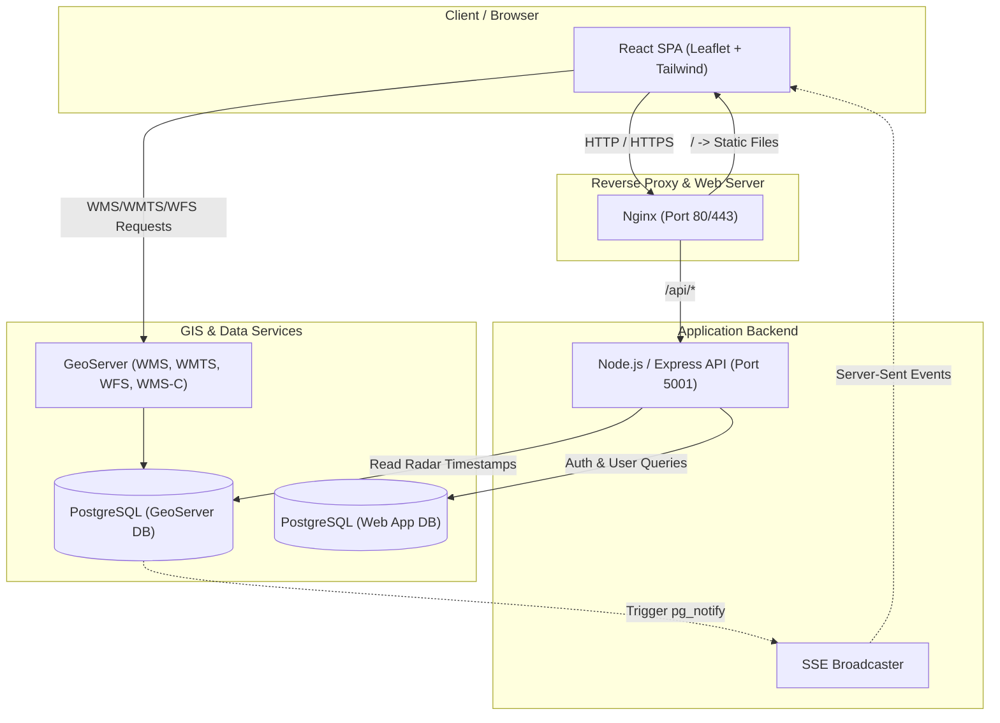

# 🛰️ Web-GIS Ra đa Pha Đin (Radar PHA System)

> Hệ thống Web-GIS giám sát dữ liệu Ra đa thời tiết thời gian thực, quản lý phân quyền và hỗ trợ biên tập, ban hành bản tin khí tượng.

---

## 📌 Mục lục

- [Tổng quan hệ thống](#-tổng-quan-hệ-thống)
- [Kiến trúc hệ thống](#-kiến-trúc-hệ-thống)
- [Công nghệ sử dụng](#-công-nghệ-sử-dụng)
- [Cấu trúc thư mục](#-cấu-trúc-thư-mục)
- [Hướng dẫn cài đặt & Khởi chạy](#-hướng-dẫn-cài-đặt--khởi-chạy)
- [Cấu hình biến môi trường](#-cấu-hình-biến-môi-trường)
- [Tổng quan tính năng](#-tổng-quan-tính-năng)
- [Tài liệu liên quan](#-tài-liệu-liên-quan)
- [Lộ trình phát triển](#-lộ-trình-phát-triển)

---

## 🌐 Tổng quan hệ thống

Hệ thống **Web-GIS Ra đa Pha Đin** được xây dựng nhằm cung cấp giải pháp trực quan hóa dữ liệu thời tiết ra đa (phản hồi vô tuyến MAX, độ cao đỉnh phản hồi HMAX,...) theo không gian và thời gian. Hệ thống hỗ trợ cán bộ khí tượng tại trạm ra đa và các đài khí tượng thủy văn tỉnh:
- Giám sát trường phản hồi mây theo chuỗi thời gian thực (Time-lapse / Animation).
- Truy vấn thông tin phản hồi vô tuyến theo tọa độ địa lý (GetFeatureInfo).
- Cập nhật tự động mốc thời gian sản phẩm mới qua Server-Sent Events (SSE) và PostgreSQL Listen/Notify.
- Phân quyền người dùng đa cấp (System Admin, Admin trạm/tỉnh, Dự báo viên).
- Nền tảng biên tập và xuất bản tin thời tiết cảnh báo mưa dông, thời tiết nguy hiểm.

---

## 🏗️ Kiến trúc hệ thống



---

## 🛠️ Công nghệ sử dụng

### Frontend
- **Framework**: [React 19](https://react.dev/) + [Vite](https://vitejs.dev/)
- **Bản đồ GIS**: [Leaflet](https://leafletjs.com/), [React-Leaflet](https://react-leaflet.js.org/), [@turf/turf](https://turfjs.org/)
- **UI & Styling**: [Tailwind CSS v4](https://tailwindcss.com/), [Lucide React Icons](https://lucide.dev/)
- **HTTP Client & Routing**: [Axios](https://axios-http.com/), [React Router DOM v7](https://reactrouter.com/)

### Backend
- **Nền tảng**: [Node.js](https://nodejs.org/) (ES Modules)
- **Web Framework**: [Express.js](https://expressjs.com/)
- **Cơ sở dữ liệu**: [PostgreSQL](https://www.postgresql.org/) (`pg` Pool)
- **Bảo mật & Xác thực**: JSON Web Token (`jsonwebtoken`), `bcrypt`, `cookie-parser`, `cors`
- **Thời gian thực**: Server-Sent Events (SSE) kết hợp PostgreSQL Trigger & `pg_notify`

### Bản đồ & Dữ liệu GIS
- **GeoServer**: Cung cấp dịch vụ WMS (GetMap, GetFeatureInfo), WMS-C Tile Caching, WMTS ranh giới, WFS GeoJSON dữ liệu trạm/ranh giới hành chính.

### Triển khai & Vận hành
- **Hệ điều hành máy chủ**: Ubuntu 20.04+ LTS
- **Reverse Proxy**: Nginx (hỗ trợ SSL Let's Encrypt, caching tĩnh, nén Gzip)
- **Quản lý tiến trình**: PM2

---

## 📁 Cấu trúc thư mục

```
Web-GIS/
├── backend/                  # Mã nguồn máy chủ Backend (Node.js/Express)
│   ├── libs/                 # Kết nối DB (dbGeoserver, dbWebApp), Listener, SQL trigger
│   │   ├── dbGeoserver.js
│   │   ├── dbWebApp.js
│   │   ├── initPostgresListener.js
│   │   └── SQL.txt
│   ├── src/
│   │   ├── controllers/      # Điều hướng nghiệp vụ (auth, user, time SSE)
│   │   ├── middleware/       # Middleware xác thực JWT (protectedRoute)
│   │   ├── routes/           # Khai báo RESTful API endpoints
│   │   └── server.js         # Entrypoint Express server
│   ├── package.json
│   └── README.md             # Tài liệu chi tiết Backend
│
├── frontend/                 # Mã nguồn giao diện Frontend (React + Vite)
│   ├── src/
│   │   ├── assets/           # Hình ảnh, biểu tượng radar, logo
│   │   ├── components/       # Các components giao diện & bản đồ
│   │   │   ├── layout/       # Header, Sidebar, MainContent
│   │   │   ├── map/          # MapView, ProductLayer, WFSLayer, MapPanes,...
│   │   │   └── ui/           # AnimationControl, LayerControlToggle, Legend,...
│   │   ├── context/          # State management (Theme, LayerToggle, Selection)
│   │   ├── lib/              # Hằng số (constants), config danh mục, tiện ích
│   │   ├── pages/            # Dashboard, NotFound
│   │   ├── App.jsx
│   │   └── main.jsx
│   ├── package.json
│   └── README.md             # Tài liệu chi tiết Frontend
│
├── deploy/                   # Cấu hình và script triển khai production
│   ├── nginx/                # File cấu hình Nginx (HTTP & HTTPS)
│   ├── deploy.sh             # Bash script tự động hóa triển khai
│   └── DEPLOY_GUIDE.md       # Hướng dẫn chi tiết triển khai máy chủ
│
├── package.json              # Root package quản lý scripts chạy song song
└── README.md                 # Tài liệu tổng quan dự án
```

---

## 🚀 Hướng dẫn cài đặt & Khởi chạy

### Yêu cầu tiên quyết
- **Node.js**: Phiên bản 18.x hoặc 20.x trở lên
- **npm**: Phiên bản 9.x hoặc 10.x trở lên
- **PostgreSQL**: Đã cấu hình CSDL ứng dụng và CSDL GeoServer

### 1. Cài đặt toàn bộ dependencies
Chạy lệnh sau tại thư mục gốc của dự án để cài đặt các gói cho cả root, backend và frontend:

```bash
npm run install:all
```

*(Hoặc cài đặt thủ công từng phần: `npm install` tại thư mục gốc, `cd backend && npm install`, `cd frontend && npm install`)*.

### 2. Khởi chạy môi trường phát triển (Development)
Khởi chạy đồng thời cả Backend (port 5001) và Frontend (port 5173):

```bash
npm run dev
```

Hoặc chạy độc lập từng dịch vụ:
- **Backend**: `npm run dev:backend`
- **Frontend**: `npm run dev:frontend`

Truy cập giao diện tại: [http://localhost:5173](http://localhost:5173)

---

## ⚙️ Cấu hình biến môi trường

### Backend (`backend/.env`)
Tạo file `backend/.env` với các tham số:

```env
PORT=5001

# Kết nối cơ sở dữ liệu Web App
DB_HOST=localhost
DB_PORT=5432
DB_USER=postgres
DB_PASSWD=your_password
DB_APP_NAME=web_gis_app

# Kết nối cơ sở dữ liệu GeoServer (chứa bảng index radar)
DB_GEO_NAME=geoserver_db

# Giới hạn số mốc ảnh lịch sử tải ban đầu
LIMIT_PRODUCTS=12

# JWT Secrets
ACCESS_TOKEN_SECRET=your_jwt_access_secret_key_here
REFRESH_TOKEN_SECRET=your_jwt_refresh_secret_key_here
```

### Frontend (`frontend/.env`)
Tạo file `frontend/.env` (tùy chọn trong môi trường production):

```env
VITE_API_BASE_URL=http://localhost:5001/api
```

---

## 🌟 Tổng quan tính năng

### 1. Bản đồ tương tác & Dữ liệu Radar
- **Lớp bản đồ nhiều tầng (Panes)**:
  - `paneMaskProvinces`: Mặt nạ che viền ranh giới.
  - `paneRadarProducts`: Lớp ảnh radar (WMS-C tile).
  - `paneDistricts`: Ranh giới cấp quận/huyện.
  - `panePointForecast`: Các điểm dự báo chuyên đề.
  - `paneBoundaryProvinces`: Viền ranh giới tỉnh.
  - `paneRadarStations`: Vị trí các trạm radar khu vực (Pha Đin, Việt Trì, Phù Liễn,...).
- **Thanh điều khiển Animation**: Play/Pause, điều chỉnh tốc độ khung hình, trượt mốc thời gian xem phản hồi radar theo chuỗi thời gian.
- **Tra cứu giá trị (GetFeatureInfo)**: Click vào điểm bất kỳ trên bản đồ để xem dBZ hoặc độ cao mây tức thời.
- **Cập nhật thời gian thực**: Khi GeoServer nạp sản phẩm radar mới vào PostgreSQL, thông qua Trigger `pg_notify`, giao diện tự động bổ sung mốc thời gian mà không cần tải lại trang.

### 2. Xác thực & Phân quyền
- Đăng ký (`/signup`), Đăng nhập (`/signin`), Đăng xuất (`/signout`).
- Refresh token xoay vòng bảo mật qua Cookie `httpOnly`.
- Quản lý định danh phiên làm việc và bảo vệ private routes qua middleware `protectedRoute`.

---

## 📖 Tài liệu liên quan

- 📘 [Tài liệu chi tiết Backend (API & Realtime)](file:///d:/Web-GIS/backend/README.md)
- 📙 [Tài liệu chi tiết Frontend (React & Leaflet)](file:///d:/Web-GIS/frontend/README.md)
- 🚀 [Hướng dẫn triển khai Nginx & PM2 (Production)](file:///d:/Web-GIS/deploy/DEPLOY_GUIDE.md)

---

## 🗺️ Lộ trình phát triển (Roadmap)

- [x] Tích hợp bản đồ Leaflet đa tầng và kết nối GeoServer WMS/WMTS/WFS.
- [x] Cơ chế SSE + Postgres Listen/Notify cho chuỗi sản phẩm radar.
- [x] Hệ thống xác thực người dùng JWT (Access / Refresh token).
- [ ] **Mô-đun Bản tin Khí tượng**:
  - Giao diện soạn thảo bản tin theo mẫu trạm Ra đa / Đài tỉnh.
  - Chụp/trích xuất ảnh trực tiếp từ bản đồ đưa vào bản tin.
  - Lưu nháp và xuất bản tin ra định dạng PDF / DOCX.
  - Ban hành bản tin qua Email, Zalo và phân phối nội bộ.
- [ ] **Mô-đun Trạng thái Hệ thống Ra đa**:
  - Giám sát thông số phần cứng, tình trạng kết nối máy phát/thu thời gian thực.
